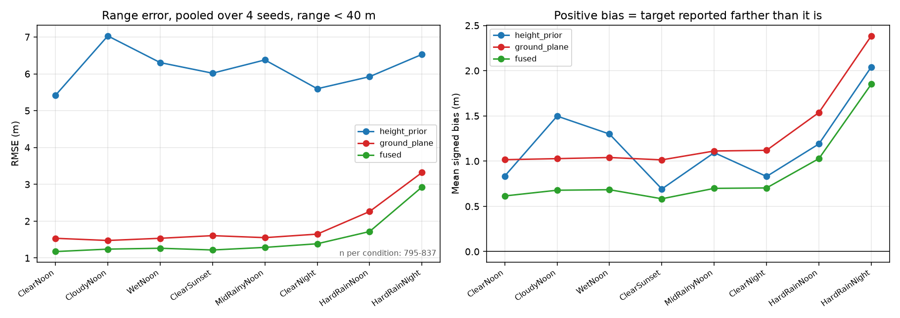
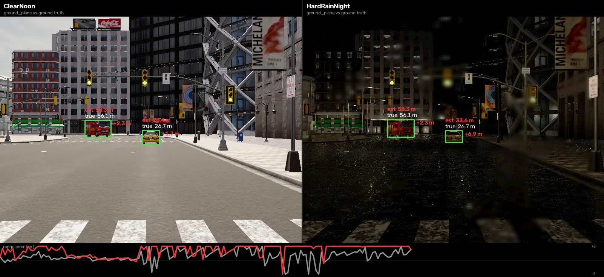
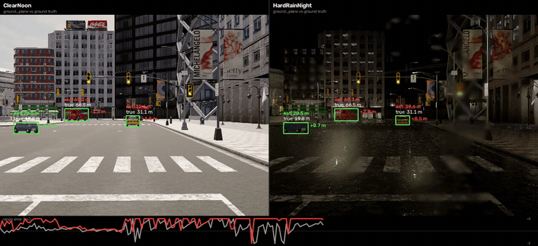

# Carla-Ranging-Validation

## Heavy rain/night makes ground-plane ranging more optimistic: capped RMSE rises 1.54 → 3.32 m and >250 ms TTC optimism rises 8% → 38%

A CARLA benchmark for camera-only vehicle ranging that measures detector recall, range error, TTC error, and brake timing — and explicitly checks whether apparent weather effects survive seed-level and range-band validation.

The perception front end is YOLO11s, COCO-pretrained and used zero-shot, with no fine-tuning on CARLA. Downstream range/TTC statistics are therefore conditional on detections that survive the detector, so detector behavior is reported alongside ranging rather than treated as a fixed upstream stage.

**Main result.** Pooling seeds 42, 43, 44, and 45 and restricting the headline comparison to `true_range_m < 40`, `ground_plane` RMSE rises from **1.54 m** in ClearNoon to **2.26 m** in HardRainNoon and **3.32 m** in HardRainNight. Mean signed bias rises from **+1.02 m** to **+1.54 m** to **+2.38 m**. From baseline to HardRainNight that is a **2.16× increase in RMSE** and a **2.35× increase in positive bias**.

Inside 40 m the retained sample count is nearly constant — **825 / 837 / 795** detections for ClearNoon / HardRainNoon / HardRainNight — so the capped comparison is much closer to like-for-like than the uncapped comparison. The cap also avoids leaning on unreliable far-field ground-plane geometry: in seed 43, **ClearNoon already has +6.17 m mean error at 60–90 m**, worse than several adverse-weather bands.

The downstream consequence is consistent across seeds. The share of TTC-window observations with optimistic `ground_plane` TTC error >250 ms rises from **8% in ClearNoon to 38% in HardRainNight**. Across seeds 42–45, ClearNoon ranges from **5.8–11.1%** while HardRainNight ranges from **20.2–52.8%**; the seed ranges do not overlap. TTC statistics are **uncapped** — the 40 m cap applies to the headline range comparison only.

The range-band result is directional rather than a universal gradient. **Fifteen of sixteen** seed × range-band comparisons have a more positive mean `ground_plane` error in HardRainNight than in ClearNoon. The lone exception is seed 45 at 40–60 m (**−0.40 m**), where ClearNoon's own mean error is unusually high (**+3.19 m**). The data do **not** support a claim that degradation monotonically increases with distance.

**Why the headline is about `ground_plane` and not the lowest-error estimator.** `fused` has lower pooled RMSE and lower bias than `ground_plane` in all eight conditions. But `ground_plane` is the only one of the three whose baseline and worst-condition seed ranges separate, so it is the only estimator for which a weather effect can be claimed at all. See *Estimator comparison* below.

## Why `ground_plane` fails

`ground_plane` estimates range from the bottom edge of the detected vehicle box under a flat-road assumption. That makes it sensitive to the image region around the tire-road contact point: reflections, glare, weak contrast, and small box-edge shifts can move the inferred contact point by a few pixels.

That pixel error becomes range error. In this experiment the retained detections are biased mostly positive: the vehicle is estimated too far away, TTC is overestimated, and a range-based brake trigger moves later.

`height_prior` fails for a completely different reason, and the distinction matters. It uses box height plus a class-height prior, so its dominant error is the prior itself rather than weather. The stationary target in seed 42 is a `nissan.patrol_2021`. Its detected box height, projected through the camera model, implies an apparent vehicle height of **1.89 m** against the **1.50 m** car prior — a 26% mismatch, which accounts directly for the 0.18–0.21 absolute relative error measured for this estimator.

The box geometry itself is sound: 1.89 m is within 3% of the real vehicle's 1.94 m published height, so the error is the assumption, not the detection. That is also the only check in this repo that validates the label pipeline against knowledge external to the simulator.

Two things compound it. First, YOLO11s labels the same SUV `truck` in **3.0–11.8%** of seed-42 frames depending on lighting, and the 3.20 m truck prior overestimates range by 113% on those frames. The flip rate is highest in CloudyNoon (11.8%) and lowest in HardRainNight (3.0%). Second, the sign of the prior error depends on which vehicles a seed happens to sample: `height_prior` mean bias is negative in seed 42 and positive in seed 43 against the same fixed priors.

The consequence is that `height_prior`'s error does not order by weather at all. Its worst pooled condition is **CloudyNoon (7.03 m RMSE)**, not HardRainNight (6.53 m).

Detector dropout is a separate population-shift risk, but it is **not a universal seed-level mechanism** in these runs. In seed 45, HardRainNight removes distant, high-error detections strongly enough to reverse an uncapped range comparison. Seed 44 does not show the same pattern: it has **44 far-field detections in HardRainNight versus 20 in ClearNoon**. The repo therefore treats survivorship as something to test per seed, not as the headline explanation for every weather result.

## What is measured

The scenario is a fixed seeded route through 20 background NPCs plus one spawned stationary target, not a single-target scene. CARLA depth and actor state provide reference geometry.

Twenty background NPCs are spawned, but only a few ever satisfy the label filters (16 px minimum box height, 400 px² minimum area, 30% minimum visibility, 100 m maximum range). In seed 42, three distinct vehicles produce labelled observations: the spawned target (`nissan.patrol_2021`, 116 observations), `citroen.c3` (46), and `audi.a2` (45). Observation counts in the hundreds therefore represent a handful of actor trajectories observed continuously, not independent samples. Reported `n` is an observation count; confidence in any per-condition difference rests on the four-seed spread, not on `n`.

Class information for `height_prior` comes from the **detector's** predicted COCO class, not from CARLA actor metadata. An earlier version of this pipeline derived the class from the simulator blueprint id, which gave the estimator information no camera-only system has; see *Validation engineering* below.

The camera uses a 60° field of view (`fy ≈ 693 px`). With a 16 px minimum detected-box height, a 1.5 m car falls below the usable height floor beyond roughly 65 m. The spawned target begins around 90 m away, but it is not labelled/detected for this measurement until it is closer, so the effective ranging window is approximately 65 m to contact, not 90 m to contact.

The pipeline runs YOLO11s (COCO-pretrained, zero-shot, no CARLA fine-tuning) and evaluates three monocular range outputs:

- `ground_plane` — range from the box bottom edge and road-plane geometry
- `height_prior` — range from box height and a class-height prior, with the class taken from the detector
- `fused` — inverse-variance weighted combination of the two

Closing speed comes from simulator ground truth. TTC is computed as `range / closing_speed` with closing speed as a scalar longitudinal difference, which is appropriate for this scenario — the ego drives a straight route toward targets ahead — but it is not a general line-of-sight collision TTC and should not be read as one.

The TTC window is observations with `true TTC < 5 s`. Within that window, **597 of 645 vehicle observations (92%) are stationary vehicles**, typically about two stationary vehicles per run. That composition matters when interpreting TTC and braking results.

## Why TTC error instead of mAP?

mAP tells you whether the detector found the object and how well the box overlaps. It does not tell you whether a small box error makes the target look metres farther away, or whether that error moves a braking decision by hundreds of milliseconds.

Detector recall is still reported because missed detections change the population on which ranging is evaluated. The repo therefore reports both upstream detection behavior and downstream geometric consequences:

- detector recall by condition/seed, and per vehicle
- range RMSE and signed bias, with a stated range cap for headline comparisons
- TTC error for observations with `true TTC < 5 s`
- fraction of TTC-window observations with optimistic TTC error >250 ms
- brake-trigger latency at the event level

Precision is **not** reported, deliberately. The detector produces 18–55 unmatched vehicle boxes per condition in seed 42, but these are not all false positives: the ground-truth label set is filtered by box size, visibility, and range, so a correct detection of a small, distant, or partly occluded vehicle has no label to match against and is counted as unmatched. Computing precision from this data would require relaxing the label filters and re-running the matcher.

# Results

## Range error: capped headline comparison

Seeds 42, 43, 44, and 45 are pooled. Headline range statistics use only detections with `true_range_m < 40`.

| Condition | n (`true_range_m < 40`) | `ground_plane` RMSE | Mean bias |
| --- | ---: | ---: | ---: |
| ClearNoon | 825 | **1.54 m** | **+1.02 m** |
| HardRainNoon | 837 | **2.26 m** | **+1.54 m** |
| HardRainNight | 795 | **3.32 m** | **+2.38 m** |

From ClearNoon to HardRainNight, RMSE increases **2.16×** and positive bias increases **2.35×**. The progression is monotone across the three severity anchors.

The cap is not cosmetic. Within 40 m the detector retains a near-constant number of observations across conditions (**825 / 837 / 795**), making the comparison substantially more like-for-like. Outside that region, far-field `ground_plane` error is already large in clean conditions and detector population shifts can distort uncapped comparisons. In seed 45 specifically, dropout removes distant high-error detections strongly enough to flatter HardRainNight; that behavior does not replicate in every seed.



## Estimator comparison

All three estimators, pooled across four seeds, `true_range_m < 40`:

| Condition | n | `height_prior` RMSE | `ground_plane` RMSE | `fused` RMSE | `height_prior` bias | `ground_plane` bias | `fused` bias |
| --- | ---: | ---: | ---: | ---: | ---: | ---: | ---: |
| ClearNoon | 825 | 5.42 | 1.54 | **1.17** | +0.83 | +1.02 | +0.61 |
| CloudyNoon | 837 | 7.03 | 1.48 | **1.24** | +1.50 | +1.03 | +0.68 |
| WetNoon | 825 | 6.31 | 1.54 | **1.26** | +1.30 | +1.04 | +0.68 |
| ClearSunset | 826 | 6.02 | 1.61 | **1.22** | +0.69 | +1.01 | +0.58 |
| MidRainyNoon | 818 | 6.38 | 1.55 | **1.29** | +1.09 | +1.11 | +0.70 |
| ClearNight | 815 | 5.60 | 1.65 | **1.39** | +0.83 | +1.12 | +0.70 |
| HardRainNoon | 837 | 5.92 | 2.26 | **1.72** | +1.19 | +1.54 | +1.03 |
| HardRainNight | 795 | 6.53 | 3.32 | **2.93** | +2.04 | +2.38 | +1.85 |

Three things to read from this table:

**`fused` has the lowest error in every condition,** on both RMSE and bias. That is a real result and it is reported as such. It is *not* evidence that the fusion model is correct — see Limitations.

**`height_prior` is an order of magnitude worse and does not respond to weather.** Its range is 5.42–7.03 m across all eight conditions, its worst condition is CloudyNoon, and its best is ClearNoon — a 1.6 m spread with no severity ordering. Class-prior mismatch dominates it.

**Only `ground_plane` separates across seeds.** Seed-level >250 ms TTC optimism ranges, ClearNoon versus HardRainNight:

| Estimator | ClearNoon | HardRainNight | Verdict |
| --- | ---: | ---: | --- |
| `ground_plane` | 5.8–11.1% | 20.2–52.8% | separated |
| `height_prior` | 2.5–92.5% | 4.4–80.0% | overlapping |
| `fused` | 1.2–16.7% | 7.0–57.6% | overlapping |

A weather claim requires the baseline and worst-condition seed ranges not to overlap. Only `ground_plane` meets that bar, which is why it carries the headline despite having higher absolute error than `fused`.

## Range-band consistency — direction holds, gradient does not

The table below reports the HardRainNight minus ClearNoon difference in mean `ground_plane` range error by true-range band and seed.

| Range band | Seed 42 | Seed 43 | Seed 44 | Seed 45 |
| --- | ---: | ---: | ---: | ---: |
| 60–90 m | +8.36 m | +0.47 m | +8.22 m | +5.56 m |
| 40–60 m | +3.31 m | +1.32 m | +5.30 m | **−0.40 m** |
| 20–40 m | +0.50 m | +2.50 m | +2.63 m | +1.02 m |
| 0–20 m | +0.48 m | +1.06 m | +0.42 m | +0.55 m |

**Fifteen of sixteen** seed × band comparisons are positive. The exception is seed 45 at 40–60 m (**−0.40 m**), where ClearNoon's own error in that band is unusually high (**+3.19 m**, roughly double any other seed's baseline) rather than HardRainNight's being unusually low.

The data do **not** support a universal distance gradient. Three seeds show a strong far-field increase; seed 43 is nearly flat at 60–90 m (**+0.47 m**) and peaks at 20–40 m (**+2.50 m**). Three-for-one is not replication, so the monotonic-distance claim remains rejected.

A second reason not to make the far field the headline is that clean-weather `ground_plane` ranging is already poor there: **ClearNoon at 60–90 m has +6.17 m mean error in seed 43**. That independently supports the 40 m headline cap.

## Detector recall

HardRainNight is the lowest-recall condition in every seed, but the magnitude is not reproducible. Condition-to-condition spread is **4.7 points in seed 43**, **17.4 in seed 42**, and roughly **34 in seed 45**. In seed 43 the clear and adverse conditions interleave — ClearNight is the highest-recall condition (98.8%) and HardRainNoon (98.2%) beats ClearNoon (96.4%). As anchor examples, seed 42 falls from 97.1% to 80.7% and seed 45 from 89.2% to 55.4%, but seed 43 only from 96.4% to 94.1%.

Breaking seed 42 down per vehicle shows why the aggregate is unstable:

| Vehicle | GT observations per condition | Worst condition | Pattern |
| --- | ---: | ---: | --- |
| `nissan.patrol_2021` (target) | 116 | 98.3% | effectively flat; never materially missed |
| `citroen.c3` | 46 | 84.8% | WetNoon and HardRainNight both 84.8% — no severity ordering |
| `audi.a2` | 45 | 31.1% | 91–98% in seven conditions, then 14/45 in HardRainNight |

The 97.1% → 80.7% drop is almost entirely `audi.a2`, the smallest vehicle in the scene, failing in the single worst condition. The approach target is never lost.

This matters in two directions. Missed detections can change which observations reach the range/TTC evaluator, so seed-level population checks are required before interpreting uncapped downstream metrics. But recall degradation and range degradation in these runs happen to **different vehicles** — the range result is measured on a target that is always detected — so "the detector gets worse, therefore range gets worse" is not the mechanism here.

## TTC consequence

| Result | Finding |
| --- | --- |
| TTC window | Observations with `true TTC < 5 s`, uncapped in range |
| `ground_plane`, optimistic TTC error >250 ms | **8% → 38%** of TTC-window observations from ClearNoon to HardRainNight |
| Seed consistency | ClearNoon: **5.8–11.1%**; HardRainNight: **20.2–52.8%** across seeds 42–45; no overlap |
| TTC-window composition | **597/645 (92%)** stationary-vehicle observations, typically about two per run |
| Missed detections inside the TTC window | Not a material factor: in seed 42 the approach target is detected in **114–116 of 116** frames in every one of the eight conditions |
| `height_prior` | Seed ranges overlap (2.5–92.5% vs 4.4–80.0%); no weather effect claimed |
| `fused` | Seed ranges overlap (1.2–16.7% vs 7.0–57.6%); no weather effect claimed despite lower pooled error |
| Brake latency | 5 events across four seeds; `ground_plane` mean trigger latency +187 ms → +363 ms, which is only **1.1× the pooled seed spread** |

The range and TTC results contain many observations, but those observations are not independent: they are continuous tracks of a small number of actors, and they are conditional on detector behavior and scene composition. Brake latency is reported rather than claimed — five events across four seeds, a 0.2 miss rate for `ground_plane` and `fused`, and a condition difference barely larger than the seed-to-seed spread.

## Qualitative comparison

Static frame:



GitHub-renderable animation:



The source video is generated locally by `src/make_video.py` as `results/comparison.avi` and is gitignored; the committed PNG and GIF are the repository-host-friendly views.

## Condition matrix

The experiment sweeps eight weather/lighting conditions from the clean baseline through heavy rain and night. The key severity anchors reported above are:

- ClearNoon
- HardRainNoon
- HardRainNight

The complete matrix and severity ordering live in `configs/conditions.yaml`; both capture and analysis read the same configuration. All reported runs use `-quality-level=Low`, so every result is conditioned on that CARLA renderer setting.

## What this does not prove

This repo does not claim that:

- range degradation grows monotonically with distance — the seed-level range-band gradient does not replicate
- adverse weather always removes a disproportionately distant population — the strong survivorship reversal is demonstrated in seed 45, not every seed
- the degradation is concentrated only in the near field — 15 of 16 HardRainNight–ClearNoon seed × band differences are positive across the evaluated range
- brake latency is statistically well powered — five events across four seeds, and the condition difference is 1.1× the seed spread
- detector recall degradation has a reproducible magnitude — the condition spread ranges from 4.7 to roughly 34 points across seeds, so only the direction replicates
- `height_prior` becomes competitive under any condition — pooled at the 40 m cap it is 5.4–7.0 m RMSE against `ground_plane`'s 1.5–3.3 m, in every condition
- weather is a significant source of `height_prior` error — class-prior mismatch and class instability dominate it, and its worst condition is CloudyNoon
- `fused`'s lower pooled error validates the fusion model — the gain is bias cancellation between two estimators whose errors are not independent, and `fused`'s own seed ranges overlap
- a weather effect is demonstrated for `height_prior` or `fused` — only `ground_plane`'s baseline and worst-condition seed ranges separate
- the observation counts are independent samples — they are continuous tracks of three vehicles in seed 42
- the result generalises beyond this map, fixed seeded route, 20 background NPCs plus one spawned stationary target, camera, detector, or `-quality-level=Low` rendering configuration
- the TTC window is a pure moving-lead-vehicle benchmark — 597/645 observations (92%) are stationary vehicles
- the TTC formulation is a general collision TTC — closing speed is a scalar longitudinal difference, valid for this straight-approach scenario only
- TTC numbers include closing-speed estimation uncertainty — closing speed comes from ground truth
- precision or false-positive rate is measured — unmatched detections are not separable from label-filter exclusions in this data
- CARLA rain/night rendering is photometrically equivalent to real weather

# Reproduce

## Requirements

| Requirement | Setup |
| --- | --- |
| OS | Windows 10/11 |
| CARLA | 0.9.15 |
| GPU | NVIDIA, 6 GB VRAM minimum |
| CPU | 6+ cores recommended |
| RAM | 16 GB minimum |
| Disk | ~30 GB free |
| Python | Conda/Miniforge |

The repo uses two environments:

- `carla38` — Python 3.8 + CARLA API
- `percep` — YOLO11s + NumPy/pandas/PyTorch/analysis

They communicate through generated dataset/result directories (`dataset/`, `dataset_s*/`, `results/`, `results_s*/`, and `results_pooled/`).

Every analysis command must run inside `percep`. The pooled range table reads parquet, which the system Python does not have an engine for.

Detector inference in the reported runs is CPU-only. Reported numbers are pinned to these versions:

```text
ultralytics  8.4.120
torch        2.13.0+cpu
model        yolo11s.pt (COCO-pretrained, downloaded by Ultralytics on first use)
```

## One-time setup

```powershell
Set-ExecutionPolicy -Scope Process -ExecutionPolicy Bypass

conda env create -f environment\carla38.yml
conda env create -f environment\percep.yml
```

Set `CARLA_ROOT` to the CARLA 0.9.15 install directory. If Defender real-time scanning slows capture, exclude the generated datasets:

```powershell
Add-MpPreference -ExclusionPath (Join-Path (Get-Location) "dataset")
Add-MpPreference -ExclusionPath (Join-Path (Get-Location) "dataset_s43")
Add-MpPreference -ExclusionPath (Join-Path (Get-Location) "dataset_s44")
Add-MpPreference -ExclusionPath (Join-Path (Get-Location) "dataset_s45")
```

## Tests

The geometry tests need no CARLA server and run in under a second:

```powershell
conda run -n percep python -m pytest tests -q
```

## Start CARLA

```powershell
.\scripts\preflight.ps1
.\scripts\start_server.ps1
.\scripts\preflight.ps1
```

The reported experiment used CARLA with `-quality-level=Low`. Preserve that renderer setting in `start_server.ps1` or the underlying `CarlaUE4.exe` launch command. The second preflight is intentional because some checks require a live CARLA server.

## Run the full experiment

The reference experiment uses 300 frames per capture and seeds 42, 43, 44, and 45.

`run_all.ps1` runs the end-to-end pipeline for the default seed (42), including detector inference and `src.make_headline`; 300 frames is the default:

```powershell
.\run_all.ps1
```

Capture the remaining seeded matrices:

```powershell
.\scripts\run_matrix.ps1 -Seed 43 -Out .\dataset_s43
.\scripts\run_matrix.ps1 -Seed 44 -Out .\dataset_s44
.\scripts\run_matrix.ps1 -Seed 45 -Out .\dataset_s45
```

The equivalent pattern for another seed is:

```powershell
.\scripts\run_matrix.ps1 -Seed N -Out .\dataset_sN
```

## Labels, detection, evaluation, and pooling for seeds 43–45

Each additional seed goes through labels → YOLO11s detection → ranging/evaluation, then all four result directories are pooled and `src.make_headline` regenerates the published 40 m figure and compact summary CSVs.

```powershell
foreach ($s in 43,44,45) { Get-ChildItem ".\dataset_s$s" -Directory | ForEach-Object { conda run -n percep python -m src.labels --run $_.FullName } }
foreach ($s in 43,44,45) { conda run --no-capture-output -n percep python -m src.detect --dataset ".\dataset_s$s" --device cpu }
foreach ($s in 43,44,45) { conda run --no-capture-output -n percep python -m src.evaluate --dataset ".\dataset_s$s" --labels detections.json --out ".\results_s$s" }
conda run --no-capture-output -n percep python -m src.pool_seeds --results results results_s43 results_s44 results_s45 --range-cutoff 40
conda run --no-capture-output -n percep python -m src.make_headline
```

`--labels detections.json` is required. The default is `labels.json`, which is the ground-truth box set; evaluating on that bypasses the detector entirely and produces identical results for every condition.

Reproduce the published 40 m capped headline table:

```powershell
conda run -n percep python -c "import pandas as pd;d=pd.concat([pd.read_parquet(f'results{s}/detections.parquet') for s in ['','_s43','_s44','_s45']]).query('true_range_m<40');print(d.groupby('condition').apply(lambda g:pd.Series({'n':len(g),'rmse':(g.ground_plane_err_m**2).mean()**0.5,'bias':g.ground_plane_err_m.mean()})).round(2).reindex(['ClearNoon','HardRainNoon','HardRainNight']))"
```

Expected headline output:

```text
                  n  rmse  bias
condition
ClearNoon      825.0  1.54  1.02
HardRainNoon   837.0  2.26  1.54
HardRainNight  795.0  3.32  2.38
```

A single 300-frame matrix is roughly 10 minutes on the reference machine. Reproducing all four seeds plus the CPU detector passes is roughly one hour end to end, excluding one-time environment setup.

The determinism check compares ego/NPC state and trajectory, not sensor-file hashes. Exact sensor bytes are not required; controlled simulator state is.

## Pipeline

| Stage | What it does | Acceptance check |
| --- | --- | --- |
| Determinism | repeats controlled runs | ego/NPC state and trajectory agree |
| Capture matrix | sweeps weather/lighting conditions across seeds | route and traffic state stay comparable |
| Labels | builds depth/semantic reference labels | overlays and diagnostics look correct |
| Detection | runs zero-shot COCO-pretrained YOLO11s | recall is reported; missing detections are not silently ignored |
| Ranging | computes `ground_plane`, `height_prior`, and `fused` | class comes from the detector, not from simulator metadata |
| Evaluation | computes range error, TTC error, and brake latency | TTC window is `true TTC < 5 s`; population shifts are checked |
| Seed pooling | aggregates four runs without hiding spread | per-estimator seed ranges are printed and checked for overlap |
| Report | writes figures, result tables, and comparison media | numbers match pooled outputs and the stated 40 m headline cap |

# Repository layout

## Capture / CARLA side

- `run_all.ps1` — orchestrates the complete pipeline.
- `scripts/preflight.ps1` — checks CARLA, environments, hardware assumptions, disk space, and live-server dependencies.
- `scripts/start_server.ps1` — starts `CarlaUE4.exe` and waits for RPC; reported results use `-quality-level=Low`.
- `scripts/carla_capture.py` — synchronous capture, seeded actors, sensor frames, and per-frame ground truth.
- `scripts/run_matrix.ps1` — sweeps the configured condition matrix.
- `scripts/verify_determinism.py` — compares ego/NPC state and trajectory across repeated runs.
- `scripts/diagnose_labels.py` — targeted diagnostics for suspicious ground-truth labels.
- `scripts/depth_edge_test.py` — checks depth discontinuities around object boundaries.

## Perception / analysis side

- `src/config.py` — loads `configs/conditions.yaml`.
- `src/labels.py` — projects actors into the image and builds depth/semantic reference labels.
- `src/detect.py` — runs YOLO11s, COCO-pretrained, zero-shot, with no CARLA fine-tuning; records the predicted COCO class per detection.
- `src/ranging.py` — implements `ground_plane`, `height_prior`, uncertainty models, and fusion.
- `src/evaluate.py` — converts range error into TTC error and brake-trigger timing.
- `src/pool_seeds.py` — pools four seeded runs while preserving seed spread.
- `src/make_headline.py` — generates the published 40 m pooled headline artifacts from the pooled seed outputs.
- `src/inspect_labels.py` — creates quick visual checks for label quality.
- `src/make_video.py` — renders the qualitative comparison video.
- `src/report.py` — generates single-seed figures and result tables.
- `check_errors.py` — computes per-range-band error comparisons between conditions for seed-level validation.

## Config / tests / outputs

- `configs/conditions.yaml` — eight-condition weather/lighting matrix and severity ordering.
- `tests/test_geometry.py` — synthetic geometry tests; no CARLA server required.
- `environment/carla38.yml` — CARLA-side environment.
- `environment/percep.yml` — detector/analysis environment.
- `results/fig1_range_error_pooled_40m.png` — committed four-seed, 40 m capped headline range-error figure.
- `results/comparison_frame.png` — committed static GitHub-renderable comparison frame.
- `results/comparison.gif` — committed GitHub-renderable qualitative comparison excerpt.
- `results/comparison.avi` — generated source video; gitignored and not present in a normal clone.
- `results_pooled/range_pooled_40m.csv` — committed pooled 40 m headline range statistics.
- `results_pooled/range_pooled.csv`, `ttc_pooled.csv`, `latency_pooled.csv` — committed pooled per-estimator tables.
- `results_pooled/range_band_by_seed.csv` — committed seed-level range-band comparison data.
- `results_pooled/recall_by_seed.csv` — committed seed-level detector recall summary.
- `dataset/`, `dataset_s*/` — generated capture data; gitignored.
- `results_s*/` — generated seed-specific analysis outputs; gitignored.

# Validation engineering: claims the data tested

The strongest part of this benchmark is not a single effect size; it is the sequence of plausible claims that were tested against seed-level data, then rejected, narrowed, or reinterpreted when the predicted mechanism did not hold.

| Hypothesis | Validation outcome |
| --- | --- |
| **Z² crossover** | Not supported. `height_prior` was expected to overtake `ground_plane` at long range because ground-plane uncertainty grows approximately as Z². Once the class prior is taken from the detector rather than from simulator metadata, `height_prior` is 5.4–7.0 m pooled RMSE against `ground_plane`'s 1.5–3.3 m, in every condition. The predicted crossover does not occur. |
| **Near-field concentration** | Not supported. Fifteen of sixteen HardRainNight–ClearNoon seed × band differences are positive across the evaluated range, so the effect is not confined to the near field. |
| **Universal survivorship mechanism** | Not supported. Seed 45 shows strong distant high-error dropout, but seed 44 has more far-field detections in HardRainNight (44) than ClearNoon (20). |
| **Range degradation grows monotonically with distance** | Not supported. Three seeds show a strong far-field increase, but seed 43 peaks at 20–40 m (+2.50 m) and is nearly flat at 60–90 m (+0.47 m). |
| **Detector dropout drives the range result** | Not supported. The vehicle that loses recall (`audi.a2`, 31.1% in HardRainNight) is not the vehicle the range and TTC results are measured on (the target, 98.3% worst case). The two degradations are independent in these runs. |
| **Weather degrades all three estimators** | Not supported. `height_prior`'s worst pooled condition is CloudyNoon, and both `height_prior` and `fused` have overlapping baseline/worst-condition seed ranges. Only `ground_plane` shows a weather effect that survives seed-level separation. |
| **Inverse-variance fusion improves TTC because the fusion model holds** | Not supported as stated, though `fused` does have the lowest pooled error. The model assumes independent errors while both estimators read the same bounding box, and the gain comes from a negative `height_prior` bias partially cancelling a positive `ground_plane` bias. Since `height_prior`'s bias sign flips between seeds, the cancellation is not a stable property. |

These checks are useful because they separate the observed effect from the mechanism originally expected. The final result is narrower but stronger: within 40 m, pooled `ground_plane` error increases monotonically with severity, and at the seed/range-band level HardRainNight is more optimistic in **15 of 16** comparisons.

Earlier development also exposed implementation/evaluation traps that could have produced convincing but wrong results:

- **Simulator metadata leaking into a camera-only estimator.** The matcher spread the ground-truth record into each matched detection, which carried the CARLA blueprint id through to ranging — so `height_prior` knew the exact vehicle model, which no camera-only system does. The detector's own predicted class was already being recorded and discarded. Switching to it raised `height_prior` RMSE by 0.5–2.7 m per condition and left `ground_plane` bit-identical, which is the expected signature: no class enters the ground-plane geometry.
- **Reference-point mismatch.** The projected 2D box was effectively tied to the near face of the 3D box while true range was taken to the centroid, creating about 2.4 m of systematic offset.
- **A benchmark that measured nothing.** For one revision, eight weather conditions produced results identical to six decimal places, because nothing in the evaluation path actually read the RGB images — the detector stage was missing and ranging ran on ground-truth boxes.
- **Wrong variation pooled in a degradation check.** Variation between estimators was mixed with variation between conditions, allowing a weather-insensitive result to pass.
- **Seed-specific survivorship reversal.** In seed 45, HardRainNight loses 107 of 282 detections; the missing detections are disproportionately distant and high-error, enough to reverse an uncapped comparison.
- **A determinism acceptance criterion that was itself wrong.** Byte-level sensor hashing fails for reasons unrelated to simulator state, and a fixed maximum depth-difference bound fails at occlusion boundaries where one pixel legitimately differs by the full depth gap. The check now compares ego/NPC state and trajectory and tests depth differences for edge explainability.

These are the kinds of validation failures that produce plausible numbers instead of exceptions. The tests and diagnostic scripts in this repo exist largely to catch that class of failure.

# Limitations

- **Headline range metrics are range-capped.** The main comparison uses `true_range_m < 40`. This improves population comparability and avoids leaning on a far field where `ground_plane` is already unreliable in clean weather. TTC statistics are uncapped.
- **Observations are not independent samples.** Seed 42 yields 207 matched observations from three vehicles, 116 of them the single target. Counts in the hundreds describe continuous tracks, not independent draws, so no confidence interval is computed from `n`. Seed spread is the only dispersion estimate reported.
- **Detector behavior is seed-dependent and vehicle-specific.** Recall degrades under adverse weather, but the condition spread ranges from 4.7 to roughly 34 points across seeds, and in seed 42 the aggregate drop is dominated by one small vehicle in one condition.
- **The range-band direction is stronger than the range-band shape.** HardRainNight–ClearNoon differences are positive in 15 of 16 seed × band comparisons, but there is no reproducible monotonic range gradient.
- **Brake latency is underpowered.** Five events across four seeds, a 0.2 miss rate for `ground_plane` and `fused`, and a ClearNoon→HardRainNight difference of +176 ms against a pooled seed spread of 156 ms — only 1.1× the noise.
- **Only `ground_plane` separates cleanly across seeds.** `height_prior` and `fused` both have overlapping baseline and worst-condition seed ranges, so no weather effect is claimed for either.
- **`height_prior` is prior-limited, and the prior error has no consistent sign.** The seed-42 target's apparent height is 1.89 m against a 1.50 m prior, and YOLO11s relabels the same vehicle `truck` in 3.0–11.8% of frames depending on lighting. Mean bias is negative in seed 42 and positive in seed 43 against identical priors, because the seeds sample different vehicles — so the error is not a calibration offset a better constant would remove. Its worst pooled condition is CloudyNoon.
- **`fused` has the lowest pooled error but that does not validate the fusion model.** Inverse-variance fusion assumes independent errors; both estimators read the same bounding box. The gain is cancellation of a negative `height_prior` bias against a positive `ground_plane` bias, which is specific to the magnitudes in these scenes and should not be expected to transfer — particularly since the `height_prior` bias sign is not stable across seeds.
- **Precision is not measured.** Unmatched detections (18–55 per condition in seed 42) cannot be separated from label-filter exclusions without relaxing the filters and re-running the matcher.
- **The scenario is controlled but not single-target-only.** It is one map and one fixed seeded route through 20 background NPCs plus one spawned stationary target.
- **The TTC window is mostly stationary vehicles.** 597/645 observations (92%) in frames with `true TTC < 5 s` are stationary vehicles.
- **The TTC model is one-dimensional.** Closing speed is the scalar difference between ego and target longitudinal speed, not a projection of relative velocity onto the line of sight. That is appropriate for a straight approach to targets ahead and is not a general collision TTC.
- **The effective measurement range is ~65 m to contact, not 90 m.** At 60° FOV (`fy ≈ 693`), a 1.5 m car falls below the 16 px height floor beyond roughly 65 m.
- **All results are conditioned on `-quality-level=Low`.** A different CARLA rendering quality may change detector and image-error behavior.
- **Closing speed comes from ground truth.** The TTC evaluation isolates ranging error by using simulator-derived closing speed. The results exclude the additional uncertainty a real system would introduce by estimating relative velocity, and are not a guaranteed lower bound on its total error.
- **CARLA weather is not photometrically validated against the real world.** The simulator supports controlled relative comparisons; the absolute degradation should not be transferred directly to real rain or night driving.

# Credits

- CARLA simulator — Dosovitskiy, Ros, Codevilla, López, Koltun, *CARLA: An Open Urban Driving Simulator*, CoRL 2017. MIT licensed.
- YOLO11 — Ultralytics, <https://github.com/ultralytics/ultralytics>. AGPL-3.0 licensed; this repo imports the package and downloads COCO-pretrained weights at runtime rather than vendoring them.